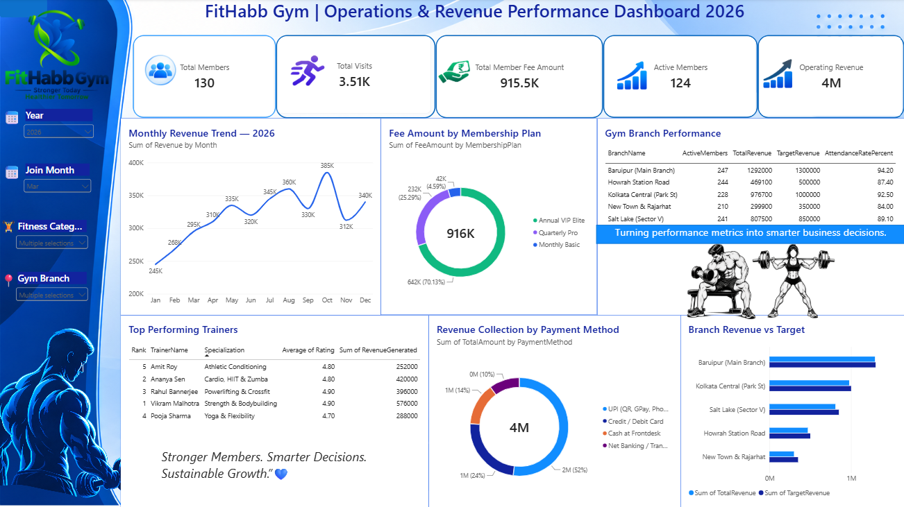

# 🏋️ FitHabb Gym | Operations & Revenue Performance Dashboard 2026

## 📊 Project Overview

FitHabb Gym is an interactive business intelligence dashboard developed using Microsoft Power BI to analyze gym membership, revenue, trainer performance, and branch operations.

The project demonstrates how data visualization can help monitor key performance indicators and support data-driven business decisions.

**Dataset Disclaimer:** This project uses sample gym operations data for educational and portfolio purposes. All figures are illustrative.

## 🎯 Project Objectives

* Monitor total and active gym members.
* Analyze monthly revenue trends.
* Compare membership plan fee contributions.
* Evaluate gym branch performance.
* Analyze trainer ratings and revenue generation.
* Understand revenue distribution by payment method.
* Compare branch revenue against targets.

## 🛠️ Tools Used

* Microsoft Power BI
* Data Visualization
* Business Intelligence
* KPI Reporting

## 📈 Dashboard Features

### 1. KPI Monitoring

Displays total members, total visits, membership fee amount, active members, and operating revenue.

### 2. Monthly Revenue Trends

Visualizes monthly revenue patterns throughout the year.

### 3. Membership Plan Analysis

Compares fee contributions from different membership plans.

### 4. Branch Performance

Analyzes active members, revenue, targets, and attendance rates across branches.

### 5. Trainer Performance

Compares trainer rankings, specializations, ratings, and revenue generated.

### 6. Payment Method Analysis

Visualizes revenue distribution across different payment methods.

### 7. Revenue vs. Target

Compares actual revenue with target revenue for each branch.

## 🖼️ Dashboard Preview

## 📚 Key Learnings

This project helped me practise dashboard design, KPI reporting, data visualization, and business performance analysis.

## 👤 Author

Data Analytics Portfolio Project

**Tool:** Microsoft Power BI
